# hey, I'm Chirag :)

computer science @ ut dallas 
currently building @ [Module Prep](https://github.com/Module-Prep)

<a href="https://moduleprep.com"><picture><source media="(prefers-color-scheme: dark)" srcset="widgets/now-dark.svg">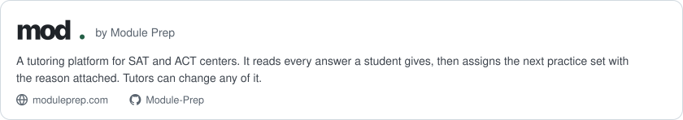</picture></a>

### Tech stack

<picture><source media="(prefers-color-scheme: dark)" srcset="widgets/stack-dark.svg">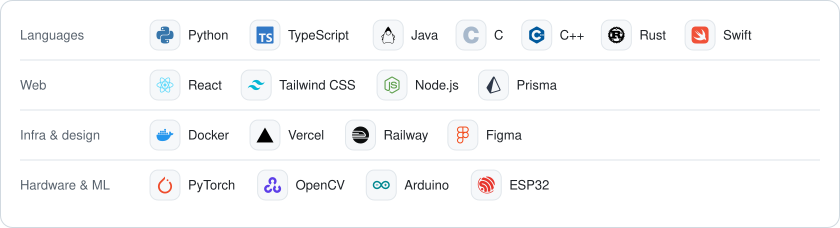</picture>

### Projects

<a href="https://github.com/chxrro/wayfeel"><picture><source media="(prefers-color-scheme: dark)" srcset="widgets/p-wayfeel-dark.svg">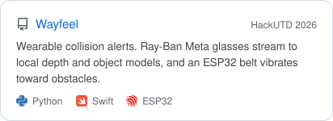</picture></a>
<a href="https://github.com/chxrro/cua-bridge"><picture><source media="(prefers-color-scheme: dark)" srcset="widgets/p-cua-bridge-dark.svg">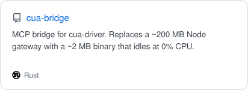</picture></a>
<a href="https://github.com/chxrro/teslacan"><picture><source media="(prefers-color-scheme: dark)" srcset="widgets/p-teslacan-dark.svg">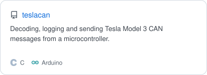</picture></a>
<a href="https://github.com/chxrro/hackutd-scrabblebot"><picture><source media="(prefers-color-scheme: dark)" srcset="widgets/p-scrabblebot-dark.svg">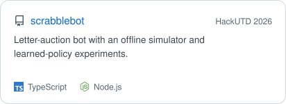</picture></a>
<a href="https://gist.github.com/chxrro/46b3489d3254e0d1443f9f0d3c3b36d1"><picture><source media="(prefers-color-scheme: dark)" srcset="widgets/p-whitepaper-dark.svg">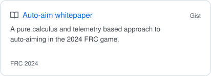</picture></a>
<picture><source media="(prefers-color-scheme: dark)" srcset="widgets/p-colophon-dark.svg">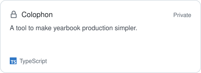</picture>

### Contributed to

<a href="https://github.com/Vortx3735/2025-Bot"><picture><source media="(prefers-color-scheme: dark)" srcset="widgets/c-2025-bot-dark.svg">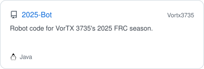</picture></a>
<a href="https://github.com/Vortx3735/VorTXObsidian"><picture><source media="(prefers-color-scheme: dark)" srcset="widgets/c-vortx-obsidian-dark.svg">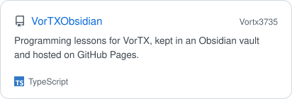</picture></a>

### GitHub stats

<picture><source media="(prefers-color-scheme: dark)" srcset="widgets/stats-dark.svg">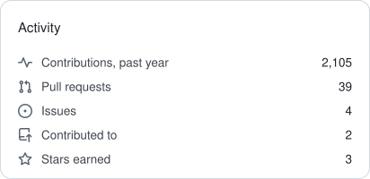</picture>
<picture><source media="(prefers-color-scheme: dark)" srcset="widgets/languages-dark.svg">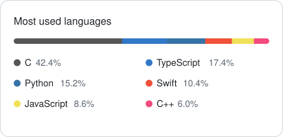</picture>

### Contact

<a href="https://discord.com/users/476148477487874048"><picture><source media="(prefers-color-scheme: dark)" srcset="widgets/discord-dark.svg"></picture></a>
<a href="https://chxrro.dev"><picture><source media="(prefers-color-scheme: dark)" srcset="widgets/site-dark.svg"></picture></a>
